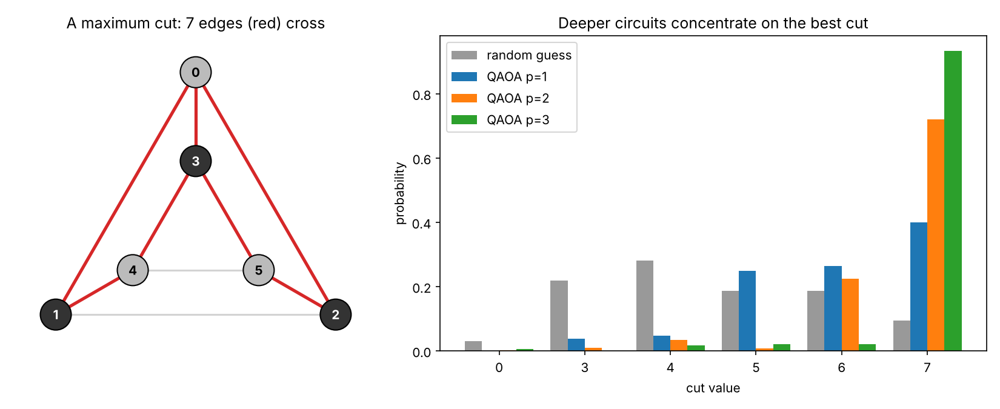

# quantum-optimization

[](https://github.com/TonyBarratt100/quantum-optimization/actions/workflows/tests.yml)
[](LICENSE)

Quantum optimisation in [Qiskit](https://www.ibm.com/quantum/qiskit): the **Quantum
Approximate Optimisation Algorithm (QAOA)** applied to **MaxCut**, prepared for the IBM
Qiskit Fall Fest hackathon in Amsterdam (20–21 November 2026). It is the companion to
[quantum-walkers](https://github.com/TonyBarratt100/quantum-walkers).

**MaxCut:** split the nodes of a graph into two groups so that as many edges as possible
run between the groups. It is NP-hard in general, which makes it the standard test problem
for quantum optimisation.

**QAOA:** a short circuit with two kinds of layer. A *cost* layer gives each candidate
split a phase proportional to its cut value. A *mixer* layer lets the candidates interfere.
A classical optimiser tunes the layer angles so that good cuts interfere constructively, and
measuring the circuit then returns good cuts with high probability. More layers (*p*) can
represent better answers.



## What's here

| Path | What it does |
|---|---|
| [`qaoa_maxcut/graphs.py`](qaoa_maxcut/graphs.py) | Weighted graphs, cut values, brute-force MaxCut, and example graphs |
| [`qaoa_maxcut/qaoa.py`](qaoa_maxcut/qaoa.py) | The QAOA circuit, a fast NumPy simulation of it, the angle optimiser, and sampling on `AerSimulator` |
| [`qaoa_maxcut/hardware.py`](qaoa_maxcut/hardware.py) | Sampling the optimised circuits on an IBM quantum computer (real or fake), with readout correction |
| [`qaoa_maxcut/__main__.py`](qaoa_maxcut/__main__.py) | Command-line demo that prints the results table and saves the plot |
| [`tests/`](tests) | pytest checks covering the graph maths, the physics, and the demo |

## Results

The demo graph is the 6-node, 9-edge *prism* (two triangles joined by three edges). Its
maximum cut is 7. A random split cuts 4.5 edges on average.

`qaoa-maxcut` (or `python -m qaoa_maxcut`), 10 optimiser restarts and 1,000 shots per depth:

| p | Expected cut | Approximation ratio | P(max cut), exact | P(max cut), sampled |
|---|---|---|---|---|
| 1 | 5.94 | 0.848 | 0.401 | 0.376 |
| 2 | 6.60 | 0.943 | 0.721 | 0.707 |
| 3 | 6.84 | 0.977 | 0.933 | 0.922 |

With three layers, about 93% of measurements return an optimal cut. The sampled
frequencies agree with the exact statevector values to within shot noise.

Two honest caveats. First, this is a classical simulation of QAOA on a 6-node graph, which a
laptop solves instantly by brute force, so it demonstrates how the algorithm works, not a
quantum speed-up. Second, extra layers make better states *possible*, but the optimiser is a
local search: on a given run a deeper circuit can occasionally score lower than a shallower
one. More restarts (`--restarts`) make that less likely, and each result reports whether the
optimiser converged.

As a physics check, the tests reproduce a known result from the original QAOA paper
([Farhi, Goldstone and Gutmann, 2014](https://arxiv.org/abs/1411.4028)): on a ring with an even
number of nodes, *p* = 1 reaches exactly 3/4 of the maximum cut.

## How it works

- **Encoding:** one qubit per node. Measuring qubit *i* as 0 or 1 puts node *i* in
  group 0 or 1. Bit order follows Qiskit's little-endian convention.
- **Start:** a Hadamard on every qubit, so every split is equally likely.
- **Cost layer, angle γ:** an `RZZ(−γw)` gate on each edge of weight *w*. This applies
  exp(−iγC), where C is the cut value.
- **Mixer layer, angle β:** an `RX(2β)` gate on every qubit.
- **Optimiser:** SciPy's L-BFGS-B, started from several random angles, maximises the exact
  expected cut. The objective uses a NumPy simulation of the same state, which is several
  times faster than simulating the circuit. A test checks that the two give the same state.
- **Sampling:** the optimised circuit is run on `AerSimulator`, and the best measured
  bitstring is the answer.

## Running on IBM quantum hardware

QAOA is a hybrid algorithm: a classical computer tunes the angles and a quantum computer
prepares and measures the state. Here the tuning is done exactly on your laptop, and only
the final measurements go to the quantum computer, which keeps quota use to seconds.

Try IBM's *fake* Marrakesh first: a local copy of the real device's qubit layout, native
gates and measured noise, which needs no account and costs nothing.

```bash
pip install -e ".[ibm]"
qaoa-maxcut --backend fake_marrakesh
qaoa-maxcut --backend least-busy
```

The second command uses a real IBM quantum computer. It needs a free
[IBM Quantum Platform](https://quantum.cloud.ibm.com) account with your API key saved
(see the [quantum-error-mitigation](https://github.com/TonyBarratt100/quantum-error-mitigation)
README), and it asks before using any quota: one job of 5 circuits x 4,000 shots by default.

On fake Marrakesh (4,000 shots):

| p | Two-qubit gates on the chip | P(max cut), exact | P(max cut), measured | Measured, readout-corrected |
|---|---|---|---|---|
| 1 | 31 | 0.401 | 0.384 | 0.395 |
| 2 | 69 | 0.721 | 0.629 | 0.648 |
| 3 | 111 | 0.933 | 0.756 | 0.781 |

This shows the trade-off that matters on real hardware: each extra layer gets closer to
the best cut in theory, but adds about 40 more two-qubit gates, and each gate adds noise.
On this device model depth still wins at p = 3, but by less than the exact simulation
promises. A real chip may show the gains levelling off sooner.

How it works:

- **Readout correction.** Two calibration circuits, all |0> and all |1>, run in the same
  job on every qubit the QAOA circuits measure, and each measured bit is corrected for its
  own qubit's readout error.
- **Quiet qubits.** The prism graph contains triangles, which IBM's heavy-hex chips do not,
  so the circuits need SWAP gates to route around the chip. Qiskit's transpiler is run with
  8 seeds, and the version with the lowest expected error, from the device's published
  error rates, is kept.
- **Raw results.** IBM's own twirling and dynamical decoupling are switched off.

## Getting started

You need Python 3.11 or later (qiskit-aer requires it). CI runs on 3.11 to 3.14.

```bash
git clone https://github.com/TonyBarratt100/quantum-optimization.git
cd quantum-optimization
python3 -m venv .venv
source .venv/bin/activate
pip install -e ".[dev]"   # the package, plus pytest, ruff and mypy
```

Run the demo and the checks:

```bash
qaoa-maxcut                             # results table, and saves qaoa_maxcut.png
qaoa-maxcut --layers 1 2 3 4            # try other depths (see --help)
pytest -q                               # run the tests
ruff check . && ruff format --check .   # lint and formatting
mypy                                    # type checking
```

Use it from Python:

```python
from qaoa_maxcut import Graph, best_sampled_cut, optimize, sample

graph = Graph.from_edges(4, [(0, 1), (1, 2), (2, 3), (3, 0, 2.0)])  # optional 3rd value = weight
result = optimize(graph, layers=2, seed=1)
print(result.approximation_ratio)
print(best_sampled_cut(graph, sample(graph, result, shots=1000, seed=1)))
```

## Coding standards

- An installable package (`pyproject.toml` is the single list of dependencies), with a
  `qaoa-maxcut` command
- Type hints and docstrings on every function, checked by [mypy](https://mypy-lang.org/)
- Input validation with clear error messages: malformed graphs and counts fail loudly
  instead of quietly becoming a different problem
- Seeds for reproducible runs
- [Ruff](https://docs.astral.sh/ruff/) lint and formatting, with the tool versions pinned
- GitHub Actions installs the package, then runs lint, type checks, the tests on
  Python 3.11–3.14, and the demo on every push. Actions are pinned to exact commits, and
  the workflow can only read the repository

## Next steps

- Compare with the classical Goemans–Williamson algorithm (guaranteed ratio 0.878)
- Weighted and random graphs at larger sizes, and warm-starting deeper circuits from
  shallower ones
- Combine hardware sampling with zero-noise extrapolation from the
  [quantum-error-mitigation](https://github.com/TonyBarratt100/quantum-error-mitigation) repo
- Use IBM's native fractional RZZ gates on Heron chips, which could substantially reduce the
  two-qubit gate count

## Licence

[MIT](LICENSE)
